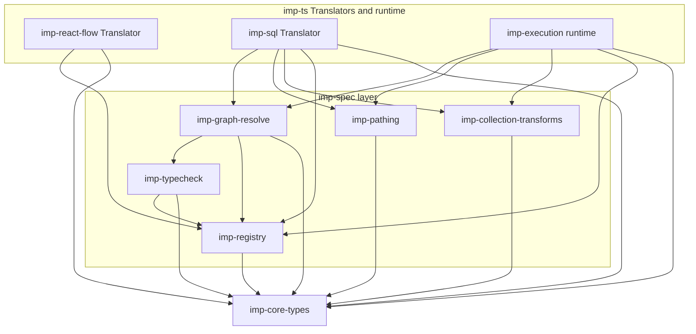

# Imp architecture

## Package dependency graph

## Layering rules

- **Library packages** (`imp-collection-transforms`, `imp-pathing`) depend only on **`imp-core-types`**. They export declarative `NodeLibrary` data.
- **`imp-registry`**, **`imp-typecheck`**, and **`imp-graph-resolve`** depend on `imp-core-types` (and registry for typecheck/resolve). Library packages **must not** depend on the registry.
- **Imp Translators** (`imp-sql`, `imp-react-flow`) and **runtime** (`imp-execution`) live in language implementations — see [imp-ts `docs/features/`](https://github.com/silentorb/imp-ts/tree/main/docs/features/). They consume registry + NodeLibrary catalogs + graph-resolve.

## Shared contracts

| Concern | Defined in | Consumed by |
| --- | --- | --- |
| Input port resolution order | [graph-model](../packages/imp-core-types/graph-model.md) | Translators, runtime |
| Core boundary nodes (`input`, `output`, `parameter`) | [graph-model](../packages/imp-core-types/graph-model.md) | NodeLibrary catalogs, Translators, runtime |
| `NodeLibrary` catalog pattern | [node-libraries](../packages/imp-core-types/node-libraries.md) | all libraries |
| `NodeImplementation` dispatch | [node-libraries](../packages/imp-core-types/node-libraries.md), [type-system](../packages/imp-typecheck/type-system.md) | Translators, runtime |
| Registry composition + conflict policy | [registry](../packages/imp-registry/registry.md) | Translators, runtime |
| Collection transform catalog | [collection-transforms](../packages/imp-collection-transforms/collection-transforms.md) | pathing, Translators, runtime |
| `traverse` hop semantics | [pathing](../packages/imp-pathing/pathing.md) | Translators, runtime |
| Semantic path bind / desugar | [semantic-paths](../packages/imp-pathing/semantic-paths.md) | query helpers, Translators (after desugar) |
| Late nested graph resolution | [resolve](../packages/imp-graph-resolve/resolve.md) | Translators, runtime |
| `search` host-delegated | [collection-transforms](../packages/imp-collection-transforms/collection-transforms.md) | Translators (not translated generically), runtime |

## Language implementations

Specs in this repo are language-neutral. Implementations provide equivalent packages:

| Spec package | TypeScript (`imp-ts`) | Rust (`imp-rs`) |
| --- | --- | --- |
| `imp-core-types` | `packages/imp-core-types` | `crates/imp_core_types` |
| `imp-registry` | `packages/imp-registry` | `crates/imp_registry` |
| `imp-typecheck` | `packages/imp-typecheck` | `crates/imp_typecheck` |
| `imp-graph-resolve` | `packages/imp-graph-resolve` | `crates/imp_graph_resolve` |
| `imp-collection-transforms` | `packages/imp-collection-transforms` | `crates/imp_collection_transforms` |
| `imp-pathing` | `packages/imp-pathing` | `crates/imp_pathing` |

**Imp Translators and runtime** (no imp-spec package docs — see [imp-ts `docs/features/`](https://github.com/silentorb/imp-ts/tree/main/docs/features/)):

| Package | TypeScript | Rust |
| --- | --- | --- |
| `imp-sql` (Translator) | `packages/imp-sql` | — (Kysely/JS only) |
| `imp-react-flow` (Translator) | `packages/imp-react-flow` | — (React only) |
| `imp-execution` (runtime) | `packages/imp-execution` | deferred |

Rust crate names use **snake_case**; npm package names use hyphenated `imp-*`. When docs and an implementation disagree, update the spec or the implementation explicitly.

## See also

- [authoring.md](./authoring.md)
- Root [AGENTS.md](../../AGENTS.md)
