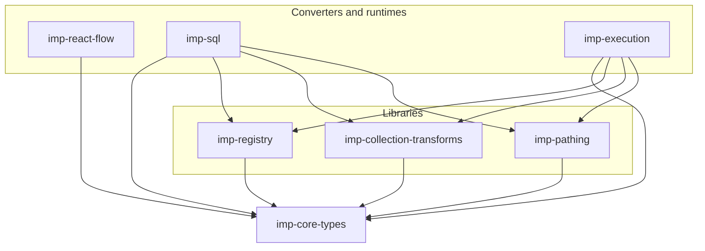

# Imp architecture

## Package dependency graph

## Layering rules

- **Library packages** (`imp-collection-transforms`, `imp-pathing`) depend only on **`imp-core-types`**. They export declarative `NodeLibrary` data.
- **`imp-registry`** depends on `imp-core-types`. Library packages **must not** depend on the registry.
- **`imp-sql`** and **`imp-execution`** depend on the registry plus the libraries they lower or execute. They implement semantics of catalog node types.
- **`imp-react-flow`** depends on `imp-core-types` (and registry for port templates). No execution or SQL.

## Dual read backends

The same Imp graph IR supports two read paths:

| Backend | Package | Role |
| --- | --- | --- |
| **Compile** | `imp-sql` | Lower collection/path graphs to SQL at compile time |
| **Execute** | `imp-execution` | Walk the DAG at runtime via a read-only host |

Hosts choose compile (relational backends) or execute (flatfile, custom stores). Operator semantics are shared; only data access differs.

## Shared contracts

| Concern | Defined in | Used by |
| --- | --- | --- |
| Input port resolution order | [graph-model](../packages/imp-core-types/graph-model.md) | sql, execution |
| Core boundary nodes (`input`, `output`, `parameter`) | [graph-model](../packages/imp-core-types/graph-model.md) | collection-transforms, pathing, sql, execution |
| `NodeLibrary` catalog pattern | [node-libraries](../packages/imp-core-types/node-libraries.md) | all libraries |
| Registry composition + conflict policy | [registry](../packages/imp-registry/registry.md) | sql, execution, react-flow |
| Collection transform catalog | [collection-transforms](../packages/imp-collection-transforms/collection-transforms.md) | pathing, sql, execution |
| `traverse` hop semantics | [pathing](../packages/imp-pathing/pathing.md) | sql, execution |
| `search` host-delegated | [collection-transforms](../packages/imp-collection-transforms/collection-transforms.md) | sql (not lowered), execution (`textSearch`) |
| Read-only default / sandboxing | [execution](../packages/imp-execution/execution.md) | parity with sql SELECT-shaped profile |

## See also

- [authoring.md](./authoring.md)
- Root [AGENTS.md](../../AGENTS.md)
